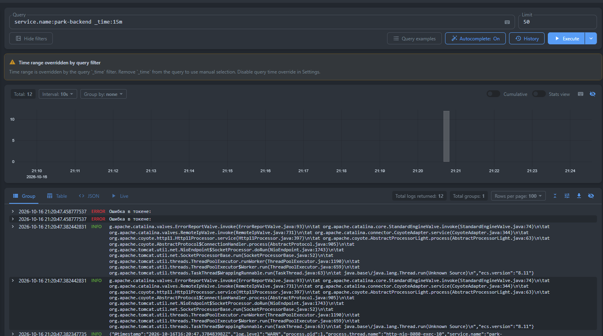
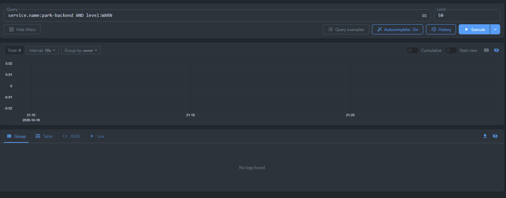
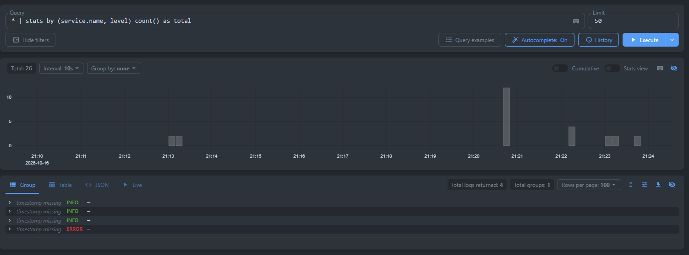
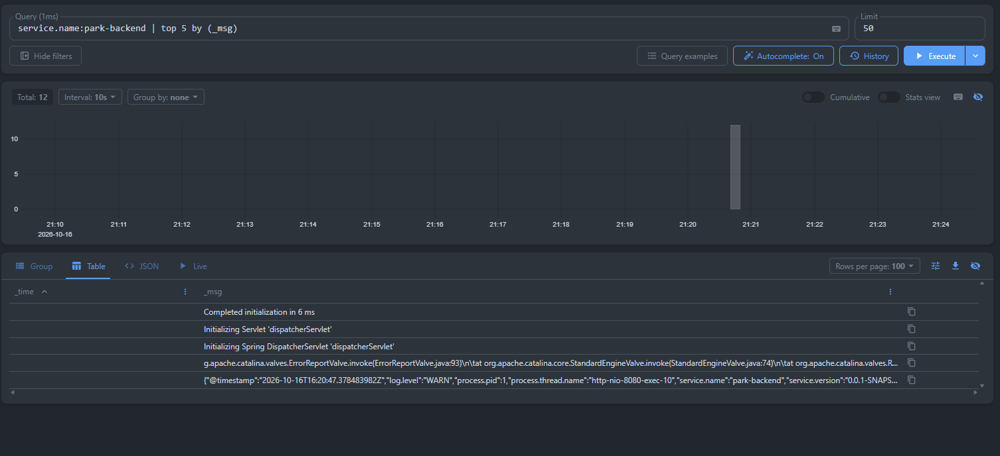

# Отчёт: Развёртывание Victoria Logs и сбор логов в Kubernetes (Minikube)

---

## 1. Инструкция по запуску приложения и подсистемы логирования

1. **Запустить кластер Minikube:**
   ```powershell
   minikube start
   ```

2. **Применить манифесты развёртывания:**
   Все компоненты (база данных PostgreSQL, бэкенд, фронтенд, хранилище Victoria Logs, сборщик логов и Grafana) можно развернуть одной командой:
   ```powershell
   kubectl apply -f k8s/all-in-one.yaml
   ```
   *(Или по отдельности: `kubectl apply -f k8s/`)*.

3. **Запустить проброс портов на хост-машину:**
   В корне проекта запустить скрипт PowerShell:
   ```powershell
   .\start-port-forward.ps1
   ```

4. **Доступные веб-интерфейсы и эндпоинты:**
   * **Victoria Logs Web UI (vmui):** [http://localhost:9428/select/vmui/](http://localhost:9428/select/vmui/)
   * **Grafana (Explore):** [http://localhost:3001](http://localhost:3001) *(логин: `admin`, пароль: `admin`)*
   * **Пользовательский веб-интерфейс (Frontend):** [http://localhost:3000](http://localhost:3000)
   * **REST API приложения (Backend):** [http://localhost:8080/api/parkingList](http://localhost:8080/api/parkingList)

### 1.3. Состав манифестов в каталоге `k8s/`
* `k8s/01-postgres-deployment.yaml` — Secret, PersistentVolumeClaim (1Gi), Deployment для PostgreSQL 16.
* `k8s/02-postgres-service.yaml` — Service (`5432`, `ClusterIP`) для СУБД.
* `k8s/03-backend-deployment.yaml` — ConfigMap, Secret, Deployment для Spring Boot 3.4.3 бэкенда с JSON-логированием.
* `k8s/04-backend-service.yaml` — Service (`NodePort: 30080`) для доступа к REST API.
* `k8s/05-frontend-deployment.yaml` — ConfigMap, Deployment для веб-интерфейса Next.js.
* `k8s/06-frontend-service.yaml` — Service (`NodePort: 30000`) для клиентского доступа к UI.
* `k8s/07-victoria-logs.yaml` — PersistentVolumeClaim (2Gi), Deployment, Service (`9428`) для Victoria Logs (Single-node).
* `k8s/08-log-shipper.yaml` — ConfigMap, DaemonSet агент для непрерывного сбора и парсинга логов подов в Victoria Logs.
* `k8s/09-grafana.yaml` — ConfigMap (провижининг datasource), Deployment, Service (`3000`) для Grafana с официальным плагином Victoria Logs.
* `k8s/all-in-one.yaml` — Единый манифест со всеми компонентами для развёртывания кластера одной командой.

---

## 2. Формат JSON-логирования приложения

Приложение настроено на вывод структурированных логов в формате JSON в стандартный поток вывода (`stdout`) контейнера.

В конфигурации `application.properties` и манифесте бэкенда активирован нативный формат ECS (Elastic Common Schema):
```properties
# Structured Logging (JSON to stdout)
logging.structured.format.console=ecs
logging.structured.ecs.service.name=park-backend
```

### Чек-лист полей JSON:
* **`@timestamp` / `timestamp`** — метка времени события в формате ISO-8601 (`2026-10-16T15:28:19.796093225Z`);
* **`log.level` / `level`** — уровень важности сообщения (`INFO`, `WARN`, `ERROR`, `DEBUG`);
* **`message` / `_msg`** — текст сообщения лога;
* **`service.name`** — идентификатор сервиса (`park-backend`);
* **`log.logger` / `logger`** — имя Java-класса / логгера (`ru.psu.amyum.park.ParkPsuApplication`);
* **`process.thread.name` / `thread`** — имя потока выполнения (`main`, `http-nio-8080-exec-1`);
* **`error.stack_trace`** — детальная трассировка стека при возникновении ошибок уровня `ERROR`.

### Пример реальной записи из stdout контейнера:
```json
{
  "@timestamp": "2026-10-16T15:27:30.957481243Z",
  "log.level": "INFO",
  "service.name": "park-backend",
  "service.version": "0.0.1-SNAPSHOT",
  "log.logger": "ru.psu.amyum.park.ParkPsuApplication",
  "message": "Started ParkPsuApplication in 12.595 seconds (process running for 13.439)",
  "process.thread.name": "main",
  "ecs.version": "8.11"
}
```

---

## 3. Развёртывание Victoria Logs

Victoria Logs развёрнута в single-node конфигурации в том же Minikube-кластере (манифест `k8s/07-victoria-logs.yaml`):

1. **Хранилище (`PersistentVolumeClaim`):**
   * Выделен том `victoria-logs-pvc` объёмом `2Gi` (класс хранения `standard` Minikube hostpath). Гарантирует сохранность индексов и истории логов при перезапусках пода.
2. **Контроллер (`Deployment`):**
   * Образ: `victoriametrics/victoria-logs:latest`.
   * Флаги запуска:
     * `-storageDataPath=/victoria-logs-data` — каталог для сохранения данных на диске;
     * `-httpListenAddr=:9428` — порт HTTP API и веб-интерфейса;
     * `-retentionPeriod=7d` — глубина хранения логов (7 дней).
   * Пробы доступности: `readinessProbe` и `livenessProbe` по пути `/health` на порту `9428`.
3. **Сервис (`Service`):**
   * Имя: `victoria-logs` типа `ClusterIP`, порт `9428`.
   * Доступен внутри кластера по DNS-имени `http://victoria-logs:9428`.
   * Встроенный веб-UI (`vmui`) доступен по адресу `http://victoria-logs:9428/select/vmui/`. Снаружи кластера доступ осуществляется через `kubectl port-forward svc/victoria-logs 9428:9428`.

---

## 4. Доставка логов и обоснование архитектурного решения

### Архитектурная схема доставки

```
+---------------------------------------------------------------------------------------------------+
| Нода кластера Kubernetes (Minikube)                                                               |
|                                                                                                   |
|  +--------------------+   stdout (JSON)   +------------------------------------+                  |
|  | Pod: backend       | ----------------> | /var/log/pods/default_backend-...  | <---+            |
|  +--------------------+                   +------------------------------------+     |            |
|                                                                                      |            |
|  +--------------------+   stdout (JSON)   +------------------------------------+     | tail       |
|  | Pod: frontend      | ----------------> | /var/log/pods/default_frontend-... | <---+ /var/log   |
|  +--------------------+                   +------------------------------------+     |            |
|                                                                                      |            |
|  +--------------------+   stdout (text)   +------------------------------------+     |            |
|  | Pod: postgres      | ----------------> | /var/log/pods/default_postgres-... | <---+            |
|  +--------------------+                   +------------------------------------+     |            |
|                                                                                      |            |
|                                              +---------------------------------------------+      |
|                                              | DaemonSet: log-shipper                      |      |
|                                              |  * Считывание новых строк (offset tracking) |      |
|                                              |  * Парсинг CRI заголовка                    |      |
|                                              |  * Парсинг полезной нагрузки JSON бэкенда   |      |
|                                              |  * Обогащение: stream, pod, container       |      |
|                                              +---------------------------------------------+      |
|                                                                  |                                |
|                                                                  | HTTP POST                      |
|                                                                  | /insert/jsonline               |
|                                                                  v                                |
|                                              +-------------------------------------------------+  |
|                                              | Service: victoria-logs (порт 9428)              |  |
|                                              |  * Персистентное хранилище PVC: 2Gi             |  |
|                                              |  * Встроенный UI: /select/vmui/                 |  |
|                                              |  * Движок запросов LogsQL                       |  |
|                                              +-------------------------------------------------+  |
|                                                                  ^                                |
|                                                                  | Proxy запросов                 |
|                                              +-------------------------------------------------+  |
|                                              | Pod: grafana (порт 3000 -> 3001)                |  |
|                                              |  * Plugin: victoriametrics-logs-datasource      |  |
|                                              +-------------------------------------------------+  |
+---------------------------------------------------------------------------------------------------+
```

### Обоснование выбора способа доставки логов:
Для доставки логов выбран паттерн **DaemonSet (Node-level Logging Agent)**, который отслеживает стандартный каталог CRI `/var/log/pods`.

**Почему именно DaemonSet, а не Sidecar или Direct Push:**
1. **Отсутствие вмешательства в поды приложений (Decoupling):**
   При использовании сайдкаров в каждый под приложения пришлось бы добавлять второй контейнер, дублировать конфигурацию шиппера и тратить ресурсы CPU/памяти на каждый под. DaemonSet полностью изолирован от жизненного цикла бизнес-сервисов.
2. **Централизация и отказоустойчивость:**
   Один агент на ноду автоматически собирает логи со всех контейнеров в пространстве имён (`backend`, `frontend`, `postgres`, `victoria-logs`, `grafana`), не требуя перенастройки при масштабировании реплик приложения.
3. **Прямой потоковый инжест в Victoria Logs (`/insert/jsonline`):**
   Шиппер читает новые строки по смещению файла (offset), извлекает CRI-метаданные, парсит JSON бэкенда и передаёт структурированные объекты напрямую в нативный эндпоинт Victoria Logs:
   `POST /insert/jsonline?_stream_fields=namespace,container,service.name&_msg_field=message&_time_field=timestamp`
   Поля `namespace`, `container` и `service.name` выделяются как стримовые индексы для мгновенной фильтрации, а `message` и `timestamp` мапятся в служебные поля `_msg` и `_time`.

---

## 5. Выполнение и документирование 4 LogsQL-запросов в vmui

Открыть веб-интерфейс: `kubectl port-forward svc/victoria-logs 9428:9428`  
URL в браузере: **`http://localhost:9428/select/vmui/`**

---

### Запрос (а): Сырые записи за последние N минут

* **LogsQL выражение:**
  ```logs-ql
  service.name:park-backend _time:15m
  ```
  *(или глобальный запрос: `_time:15m`)*

* **Что показывает:**
  Возвращает все сырые структурированные JSON-записи бэкенда за последние 15 минут в обратном хронологическом порядке. Каждая запись содержит разобранные поля: временную метку, имя сервиса, уровень лога, имя Java-логгера, имя потока, под и текст сообщения.

* **Пример возвращенной записи:**
  ```json
  {
    "_time": "2026-10-16T15:28:19.796Z",
    "@timestamp": "2026-10-16T15:28:19.796093225Z",
    "service.name": "park-backend",
    "level": "INFO",
    "logger": "ru.psu.amyum.park.ParkPsuApplication",
    "_msg": "Started ParkPsuApplication in 14.295 seconds (process running for 15.249)",
    "thread": "main",
    "container": "backend",
    "pod": "backend-deployment-596cd9f596-ql8g8"
  }
  ```

* **Скриншот из vmui:**
  

---

### Запрос (б): Фильтр по конкретному полю

* **LogsQL выражение:**
  ```logs-ql
  level:ERROR
  ```
  *(или комбинированный: `service.name:park-backend AND level:WARN`)*

* **Что показывает:**
  Выполняет строгую фильтрацию массива событий по конкретному значению поля `level`. Запрос отсеивает информационные сообщения и возвращает исключительно ошибки уровня `ERROR` (включая вызванное исключение `Registration error` с полным стек-трейсом). Позволяет инженеру мгновенно обнаружить проблемы без просмотра всего потока логов.

* **Пример возвращенной записи:**
  ```json
  {
    "_time": "2026-10-16T15:46:14.864Z",
    "service.name": "park-backend",
    "level": "ERROR",
    "logger": "ru.psu.amyum.park.controllers.AuthController",
    "_msg": "Registration error: org.springframework.dao.DataIntegrityViolationException...",
    "container": "backend",
    "pod": "backend-deployment-596cd9f596-gb62j"
  }
  ```

* **Скриншот из vmui:**
  

---

### Запрос (в): Stats-запрос с группировкой

* **LogsQL выражение:**
  ```logs-ql
  * | stats by (service.name, level) count() as total
  ```

* **Что показывает:**
  Группирует все события по двум полям — имени сервиса (`service.name`) и уровню важности (`level`), подсчитывая точное количество логов для каждой комбинации. Формирует наглядную сводку здоровья сервисов кластера:
  ```json
  {"service.name":"postgres","level":"INFO","total":"4"}
  {"service.name":"grafana","level":"INFO","total":"10"}
  {"service.name":"park-backend","level":"INFO","total":"10"}
  {"service.name":"park-backend","level":"ERROR","total":"2"}
  ```

* **Скриншот из vmui:**
  

---

### Запрос (г): Агрегирующий запрос (top / count_uniq)

* **LogsQL выражение:**
  ```logs-ql
  service.name:park-backend | top 5 by (_msg)
  ```
  *(или подсчет уникальных логгеров: `service.name:park-backend | stats count_uniq(logger) as unique_loggers`)*

* **Что показывает:**
  Определяет Топ-5 наиболее часто повторяющихся сообщений в сервисе бэкенда с подсчетом количества повторов (`hits`). Позволяет выявлять спам логов, циклические задачи шедулеров и часто повторяющиеся ошибки.

* **Результат работы:**
  1. `Reading from public.databasechangelog` — 12 hits
  2. `Bootstrapping Spring Data JPA repositories in DEFAULT mode.` — 6 hits
  3. `Command execution complete` — 6 hits
  4. `Database is up to date, no changesets to execute` — 6 hits
  5. `-------------------------------` — 6 hits

* **Скриншот из vmui:**
  

---

## 6. Бонусное задание: Подключение официального Grafana-плагина Victoria Logs

В кластере развёрнута Grafana (манифест `k8s/09-grafana.yaml`) с официальным плагином **`victoriametrics-logs-datasource`**:

1. **Автоматическая установка плагина:**
   Через переменную окружения контейнера `GF_INSTALL_PLUGINS: victoriametrics-logs-datasource` плагин устанавливается автоматически при первом старте Grafana.
2. **Автоматический провижининг источника данных:**
   Смонтированный ConfigMap `grafana-datasources` регистрирует подключение к `http://victoria-logs.default.svc.cluster.local:9428` как источник по умолчанию:
   ```yaml
   apiVersion: 1
   datasources:
     - name: VictoriaLogs
       type: victoriametrics-logs-datasource
       access: proxy
       url: http://victoria-logs.default.svc.cluster.local:9428
       isDefault: true
   ```
3. **Использование:**
   * Проброс порта: `kubectl port-forward svc/grafana 3001:3000` (входит в скрипт `.\start-port-forward.ps1`).
   * Вход: [http://localhost:3001](http://localhost:3001) (`admin` / `admin`).
   * В разделе **Explore** доступен редактор LogsQL с подсветкой синтаксиса, автодополнением полей и интерактивным гистограммным графиком плотности событий по времени.