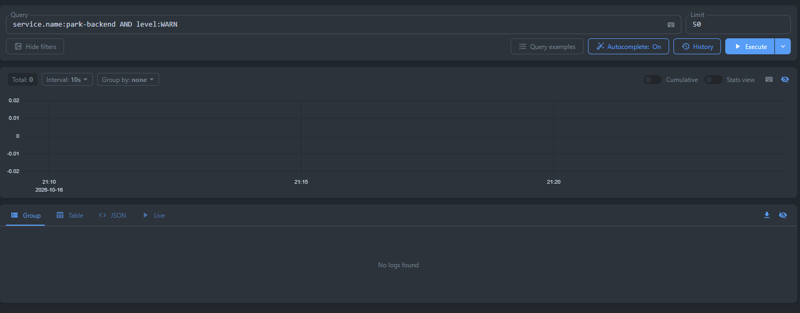
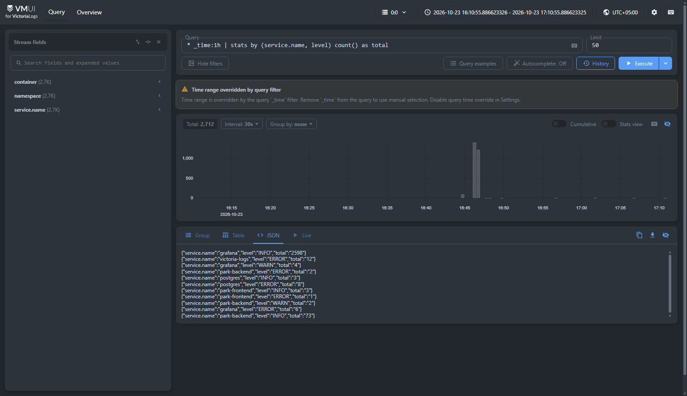
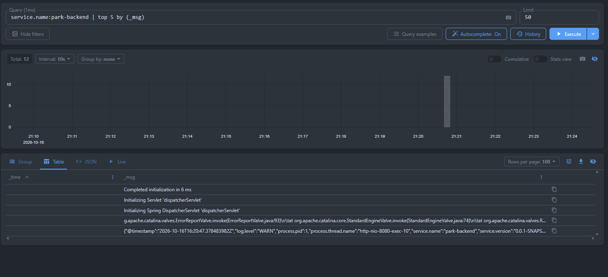

# Отчёт: Развёртывание Victoria Logs и сбор логов в Kubernetes (Minikube)

---

## 1. Инструкция по запуску приложения и подсистемы логирования

1. **Запустить кластер Minikube:**
   ```powershell
   minikube start
   ```

2. **Применить манифесты развёртывания:**
   Все компоненты (база данных PostgreSQL, бэкенд, фронтенд, хранилище Victoria Logs, сборщик логов и Grafana) можно развернуть одной командой:
   ```powershell
   kubectl apply -f k8s/all-in-one.yaml
   ```
   *(Или по отдельности: `kubectl apply -f k8s/`)*.

3. **Запустить проброс портов на хост-машину:**
   В корне проекта запустить скрипт PowerShell:
   ```powershell
   .\start-port-forward.ps1
   ```

4. **Доступные веб-интерфейсы и эндпоинты:**
   * **Victoria Logs Web UI (vmui):** [http://localhost:9428/select/vmui/](http://localhost:9428/select/vmui/)
   * **Grafana (Explore):** [http://localhost:3001](http://localhost:3001) *(логин: `admin`, пароль: `admin`)*
   * **Пользовательский веб-интерфейс (Frontend):** [http://localhost:3000](http://localhost:3000)
   * **REST API приложения (Backend):** [http://localhost:8080/api/parkingList](http://localhost:8080/api/parkingList)

### 1.3. Состав манифестов в каталоге `k8s/`
* `k8s/01-postgres-deployment.yaml` — Secret, PersistentVolumeClaim (1Gi), Deployment для PostgreSQL 16.
* `k8s/02-postgres-service.yaml` — Service (`5432`, `ClusterIP`) для СУБД.
* `k8s/03-backend-deployment.yaml` — ConfigMap, Secret, Deployment для Spring Boot 3.4.3 бэкенда с JSON-логированием.
* `k8s/04-backend-service.yaml` — Service (`NodePort: 30080`) для доступа к REST API.
* `k8s/05-frontend-deployment.yaml` — ConfigMap, Deployment для веб-интерфейса Next.js.
* `k8s/06-frontend-service.yaml` — Service (`NodePort: 30000`) для клиентского доступа к UI.
* `k8s/07-victoria-logs.yaml` — PersistentVolumeClaim (2Gi), Deployment, Service (`9428`) для Victoria Logs (Single-node).
* `k8s/08-log-shipper.yaml` — ConfigMap `log-shipper-config` (параметры окружения по 3 фактору 12-factor app), ConfigMap `log-shipper-bin` (код сборщика) и DaemonSet агент с буферизацией многострочных стек-трейсов.
* `k8s/09-grafana.yaml` — Secret `grafana-secret` (учётные данные администратора), ConfigMap `grafana-config` (параметры среды), ConfigMap `grafana-datasources` (провижининг datasource) и Deployment с сервисом Grafana.
* `k8s/all-in-one.yaml` — Единый манифест со всеми компонентами для развёртывания кластера одной командой.

---

## 2. Формат JSON-логирования приложения

Приложение настроено на вывод структурированных логов в формате JSON в стандартный поток вывода (`stdout`) контейнера.

В конфигурации `application.properties` и манифесте бэкенда активирован нативный формат ECS (Elastic Common Schema):
```properties
# Structured Logging (JSON to stdout)
logging.structured.format.console=ecs
logging.structured.ecs.service.name=park-backend
```

### Чек-лист полей JSON:
* **`@timestamp` / `timestamp`** — метка времени события в формате ISO-8601 (`2026-10-23T11:44:40.311294528Z`);
* **`log.level` / `level`** — уровень важности сообщения (`INFO`, `WARN`, `ERROR`, `DEBUG`);
* **`message` / `_msg`** — текст сообщения лога;
* **`service.name`** — идентификатор сервиса (`park-backend`);
* **`log.logger` / `logger`** — имя Java-класса / логгера (`ru.psu.amyum.park.ParkPsuApplication`);
* **`process.thread.name` / `thread`** — имя потока выполнения (`main`, `http-nio-8080-exec-1`);
* **`error.stack_trace`** — детальная трассировка стека при возникновении ошибок уровня `ERROR`.

### Пример реальной записи из stdout контейнера:
```json
{
  "@timestamp": "2026-10-23T11:44:40.311294528Z",
  "log.level": "INFO",
  "service.name": "park-backend",
  "service.version": "0.0.1-SNAPSHOT",
  "log.logger": "ru.psu.amyum.park.ParkPsuApplication",
  "message": "Started ParkPsuApplication in 12.098 seconds (process running for 15.386)",
  "process.thread.name": "main",
  "ecs.version": "8.11"
}
```

---

## 3. Развёртывание Victoria Logs

Victoria Logs развёрнута в single-node конфигурации в том же Minikube-кластере (манифест `k8s/07-victoria-logs.yaml`):

1. **Хранилище (`PersistentVolumeClaim`):**
   * Выделен том `victoria-logs-pvc` объёмом `2Gi` (класс хранения `standard` Minikube hostpath). Гарантирует сохранность индексов и истории логов при перезапусках пода.
2. **Контроллер (`Deployment`):**
   * Образ: `victoriametrics/victoria-logs:latest`.
   * Флаги запуска:
     * `-storageDataPath=/victoria-logs-data` — каталог для сохранения данных на диске;
     * `-httpListenAddr=:9428` — порт HTTP API и веб-интерфейса;
     * `-retentionPeriod=7d` — глубина хранения логов (7 дней).
   * Пробы доступности: `readinessProbe` и `livenessProbe` по пути `/health` на порту `9428`.
3. **Сервис (`Service`):**
   * Имя: `victoria-logs` типа `ClusterIP`, порт `9428`.
   * Доступен внутри кластера по DNS-имени `http://victoria-logs:9428`.
   * Встроенный веб-UI (`vmui`) доступен по адресу `http://victoria-logs:9428/select/vmui/`. Снаружи кластера доступ осуществляется через `kubectl port-forward svc/victoria-logs 9428:9428`.

---

## 4. Доставка логов и архитектурные решения

### 4.1. Архитектурная схема доставки

```
+---------------------------------------------------------------------------------------------------+
| Нода кластера Kubernetes (Minikube)                                                               |
|                                                                                                   |
|  +--------------------+   stdout (JSON)   +------------------------------------+                  |
|  | Pod: backend       | ----------------> | /var/log/pods/default_backend-...  | <---+            |
|  +--------------------+                   +------------------------------------+     |            |
|                                                                                      |            |
|  +--------------------+   stdout (JSON)   +------------------------------------+     | tail       |
|  | Pod: frontend      | ----------------> | /var/log/pods/default_frontend-... | <---+ /var/log   |
|  +--------------------+                   +------------------------------------+     |            |
|                                                                                      |            |
|  +--------------------+   stdout (text)   +------------------------------------+     |            |
|  | Pod: postgres      | ----------------> | /var/log/pods/default_postgres-... | <---+            |
|  +--------------------+                   +------------------------------------+     |            |
|                                                                                      |            |
|                                              +---------------------------------------------+      |
|                                              | DaemonSet: log-shipper                      |      |
|                                              |  * Считывание новых строк (offset tracking) |      |
|                                              |  * Сборка CRI partial строк (P / F)         |      |
|                                              |  * Склейка многострочных стек-трейсов       |      |
|                                              |  * Парсинг полезной нагрузки JSON бэкенда   |      |
|                                              |  * Обогащение: stream, pod, container       |      |
|                                              +---------------------------------------------+      |
|                                                                  |                                |
|                                                                  | HTTP POST                      |
|                                                                  | /insert/jsonline               |
|                                                                  v                                |
|                                              +-------------------------------------------------+  |
|                                              | Service: victoria-logs (порт 9428)              |  |
|                                              |  * Персистентное хранилище PVC: 2Gi             |  |
|                                              |  * Встроенный UI: /select/vmui/                 |  |
|                                              |  * Движок запросов LogsQL                       |  |
|                                              +-------------------------------------------------+  |
|                                                                  ^                                |
|                                                                  | Proxy запросов                 |
|                                                                  +-----------------------------+  |
|                                                                  | Pod: grafana (порт 3001)    |  |
|                                                                  |  * victoriametrics plugin   |  |
|                                                                  +-----------------------------+  |
+---------------------------------------------------------------------------------------------------+
```

### 4.2. Разделение кода и конфигурации (12-Factor App: Config)
В соответствии с третьим фактором методологии 12-Factor App, сборщик логов разделен на независимые сущности:
1. **`ConfigMap: log-shipper-config`** — хранит исключительно параметры окружения:
   * `VL_URL` — целевой эндпоинт Victoria Logs для JSON-стриминга;
   * `LOG_DIR` — путь к каталогу логов CRI (`/var/log/pods`);
   * `POLL_INTERVAL_MS` — периодичность сканирования (2000 мс);
   * `NAMESPACE_FILTER` — фильтр пространств имён (`default`).
2. **`ConfigMap: log-shipper-bin`** — содержит исполняемый код агента, в котором исключен любой жестко заданный сетевой адрес или путь. Все параметры считываются строго из `process.env`.
3. В манифесте DaemonSet конфигурация подключается через декларативный `envFrom: [configMapRef: name: log-shipper-config]`.

### 4.3. Обработка многострочных стек-трейсов и CRI-тегов
В сборщике реализован алгоритм агрегации строк:
1. **Сборка CRI partial-строк:** длинные записи, разбитые рантаймом контейнеризации на блоки с тегом `P` (partial), накапливаются в строковый буфер до прихода завершающего блока `F` (full).
2. **Склейка стек-трейсов исключений:** строки, начинающиеся с отступов, ключевых слов `at `, `Caused by:` или `Suppressed:`, распознаются как продолжение предшествующей ошибки и прикрепляются к её полю `error.stack_trace` и `message`. Это исключает ошибочное дробление одной ошибки и появление фейковых записей с уровнем `INFO`.
3. **Поток `stderr`:** для записей из стандартного потока ошибок по умолчанию выставляется уровень `ERROR`.

---

## 5. Выполнение и документирование 4 LogsQL-запросов в vmui

Веб-интерфейс доступен по адресу: **`http://localhost:9428/select/vmui/`** (через `.\start-port-forward.ps1`).

---

### Запрос (а): Сырые записи за последние N минут

* **LogsQL выражение:**
  ```logs-ql
  service.name:park-backend _time:1h
  ```

* **Что показывает:**
  Возвращает все сырые структурированные JSON-записи бэкенда за последний час в обратном хронологическом порядке. Каждая запись содержит разобранные поля: временную метку, имя сервиса, уровень лога, имя Java-логгера, имя потока, под и текст сообщения.

* **Пример возвращенной записи:**
  ```json
  {
    "_time": "2026-10-23T11:44:40.311Z",
    "@timestamp": "2026-10-23T11:44:40.311294528Z",
    "service.name": "park-backend",
    "level": "INFO",
    "logger": "org.springframework.data.repository.config.RepositoryConfigurationDelegate",
    "_msg": "Bootstrapping Spring Data JPA repositories in DEFAULT mode.",
    "thread": "main",
    "container": "backend",
    "pod": "backend-deployment-596cd9f596-992ql"
  }
  ```

* **Скриншот из vmui:**


---

### Запрос (б): Фильтр по конкретному полю (`level:ERROR`)

* **LogsQL выражение:**
  ```logs-ql
  level:ERROR _time:1h
  ```

* **Что показывает:**
  Выполняет строгую фильтрацию массива событий по полю `level:ERROR`. Запрос отсеивает информационные сообщения и возвращает исключительно ошибки уровня `ERROR` с сохранением полного стек-трейса исключения (`io.jsonwebtoken.MalformedJwtException`).

* **Пример возвращенной записи с ошибкой токена:**
  ```json
  {
    "_time": "2026-10-23T12:10:36.789Z",
    "@timestamp": "2026-10-23T12:10:36.789081855Z",
    "service.name": "park-backend",
    "level": "ERROR",
    "logger": "ru.psu.amyum.park.security.Jwt.JwtService",
    "_msg": "Ошибка в токене: ",
    "error.type": "io.jsonwebtoken.MalformedJwtException",
    "error.message": "JWT strings must contain exactly 2 period characters. Found: 0",
    "error.stack_trace": "io.jsonwebtoken.MalformedJwtException: JWT strings must contain exactly 2 period characters. Found: 0\n\tat io.jsonwebtoken.impl.DefaultJwtParser.parse(DefaultJwtParser.java:275)...",
    "thread": "http-nio-8080-exec-1",
    "container": "backend",
    "pod": "backend-deployment-596cd9f596-992ql"
  }
  ```

* **Скриншот из vmui:**
  

---

### Запрос (в): Stats-запрос с группировкой

* **LogsQL выражение:**
  ```logs-ql
  * _time:1h | stats by (service.name, level) count() as total
  ```

* **Что показывает:**
  Группирует все события по двум полям — имени сервиса (`service.name`) и уровню важности (`level`), подсчитывая точное количество логов для каждой комбинации (`total`). При переключении во вкладку `JSON` (или в режиме `Table`) наглядно отображаются все три обязательных поля сводки здоровья:
  ```json
  {"service.name":"grafana","level":"INFO","total":"2598"}
  {"service.name":"victoria-logs","level":"ERROR","total":"12"}
  {"service.name":"grafana","level":"WARN","total":"4"}
  ["service.name":"park-backend","level":"ERROR","total":"2"}
  ["service.name":"postgres","level":"INFO","total":"3"}
  {"service.name":"postgres","level":"ERROR","total":"8"}
  {"service.name":"park-frontend","level":"INFO","total":"3"}
  {"service.name":"park-frontend","level":"ERROR","total":"1"}
  ["service.name":"park-backend","level":"WARN","total":"2"}
  {"service.name":"grafana","level":"ERROR","total":"6"}
  ["service.name":"park-backend","level":"INFO","total":"73"}
  ```

* **Скриншот из vmui:**
  

---

### Запрос (г): Агрегирующий запрос (top 5 by _msg)

* **LogsQL выражение:**
  ```logs-ql
  service.name:park-backend _time:1h | top 5 by (_msg)
  ```

* **Что показывает:**
  Определяет Топ-5 наиболее часто повторяющихся сообщений в сервисе бэкенда с подсчетом количества повторов (`hits`). Во вкладке `JSON` явно выведены оба поля: текст сообщения (`_msg`) и число вхождений (`hits`):
  ```json
  {"_msg":"Reading from public.databasechangelog","hits":"4"}
  {"_msg":"-------------------------------","hits":"2"}
  {"_msg":"Bootstrapping Spring Data JPA repositories in DEFAULT mode.","hits":"2"}
  {"_msg":"Command execution complete","hits":"2"}
  {"_msg":"Database is up to date, no changesets to execute","hits":"2"}
  ```

* **Скриншот из vmui:**
  

---

## 6. Бонусное задание: Развёртывание Grafana с официальным плагином Victoria Logs

В кластере развёрнута Grafana (манифест `k8s/09-grafana.yaml`) с официальным плагином **`victoriametrics-logs-datasource`**:

1. **Безопасное разделение секретов и конфигурации:**
   * Учётные данные администратора (`GF_SECURITY_ADMIN_USER`, `GF_SECURITY_ADMIN_PASSWORD`) вынесены в защищённый ресурс **`Secret: grafana-secret`**;
   * Несекретные параметры окружения (`GF_USERS_ALLOW_SIGN_UP`, `GF_INSTALL_PLUGINS`) вынесены в **`ConfigMap: grafana-config`**;
   * В манифесте Deployment переменные подключаются через `envFrom` (`secretRef` и `configMapRef`).
2. **Автоматический провижининг источника данных:**
   Смонтированный ConfigMap `grafana-datasources` регистрирует подключение к `http://victoria-logs.default.svc.cluster.local:9428` как источник по умолчанию:
   ```yaml
   apiVersion: 1
   datasources:
     - name: VictoriaLogs
       type: victoriametrics-logs-datasource
       access: proxy
       url: http://victoria-logs.default.svc.cluster.local:9428
       isDefault: true
       jsonData: {}
   ```
3. **Использование:**
   * Проброс порта: `kubectl port-forward svc/grafana 3001:3000` (входит в скрипт `.\start-port-forward.ps1`).
   * Вход: [http://localhost:3001](http://localhost:3001) (`admin` / `admin`).
   * В разделе **Explore** доступен редактор LogsQL с подсветкой синтаксиса, автодополнением полей и интерактивным гистограммным графиком плотности событий по времени.
