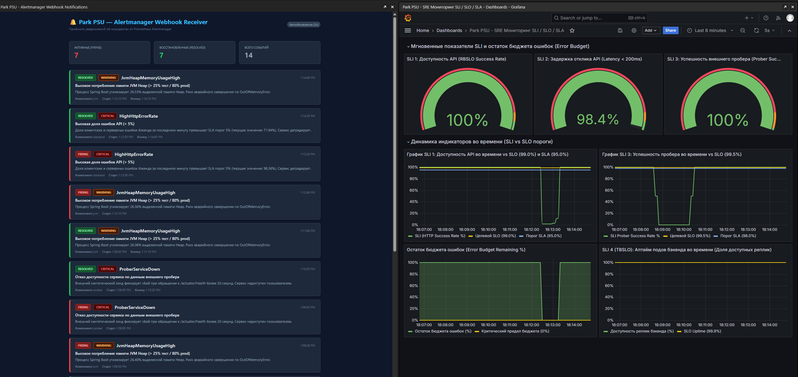

# Отчёт №6: Проектирование и реализация системы алертинга для сервиса Park PSU

---

## 1. Инструкция по запуску приложения и подсистемы алертинга

### 1.1. Порядок запуска
1. **Запустить кластер Minikube:**
   ```powershell
   minikube start
   ```

2. **Развернуть TSDB VictoriaMetrics и сборщик vmagent через Helm:**
   ```powershell
   helm repo add vm https://victoriametrics.github.io/helm-charts/
   helm repo update
   kubectl create namespace monitoring
   helm install vm-single vm/victoria-metrics-single -n monitoring -f k8s/monitoring/vmsingle-values.yaml
   helm install vmagent vm/victoria-metrics-agent -n monitoring -f k8s/monitoring/vmagent-values.yaml
   ```

3. **Развернуть инфраструктуру приложения, мониторинг и стек алертинга:**
   ```powershell
   kubectl apply -f k8s/all-in-one.yaml
   ```
   *(Либо применить отдельные манифесты: `kubectl apply -f k8s/`)*.

4. **Запустить автоматический проброс портов на хост-машину:**
   В корне проекта запустить PowerShell-скрипт:
   ```powershell
   .\start-port-forward.ps1
   ```

5. **Доступные веб-интерфейсы и эндпоинты:**
   * **Alertmanager Web UI:** [http://localhost:9093](http://localhost:9093) — просмотр активных и подавленных алертов (`Firing` / `Silenced`).
   * **Alert Webhook Receiver UI:** [http://localhost:5001](http://localhost:5001) — панель доставленных уведомлений об инцидентах в реальном времени.
   * **vmalert Web UI:** [http://localhost:8880](http://localhost:8880) — статус правил алертинга, история вычислений и текущее состояние (`Health: OK`).
   * **Grafana (SRE Дашборд SLI / SLO / SLA):** [http://localhost:3001](http://localhost:3001) *(логин: `admin`, пароль: `admin`)*.
   * **VictoriaMetrics Server (TSDB & PromQL API):** [http://localhost:8428](http://localhost:8428).
   * **Spring Boot Actuator (Prometheus metrics):** [http://localhost:8080/actuator/prometheus](http://localhost:8080/actuator/prometheus).
   * **Внешний синтетический пробер:** [http://localhost:9090/metrics](http://localhost:9090/metrics).
   * **Пользовательский интерфейс (Frontend):** [http://localhost:3000](http://localhost:3000).
   * **REST API бэкенда:** [http://localhost:8080/api/parkingList](http://localhost:8080/api/parkingList).

---

### 1.2. Состав манифестов в каталоге `k8s/`
* `k8s/01-postgres-deployment.yaml` — Secret `postgres-secret`, PVC `postgres-pvc`, Deployment PostgreSQL 16 с сайдкаром `postgres-exporter:v0.16.0` (порт `9187`).
* `k8s/02-postgres-service.yaml` — Service `postgres` (`ClusterIP`).
* `k8s/03-backend-deployment.yaml` — ConfigMap, Secret, Deployment бэкенда Spring Boot 3.4 (3 реплики, порты `8080`).
* `k8s/04-backend-service.yaml` — Service `backend` (`NodePort: 30080`).
* `k8s/05-frontend-deployment.yaml` — ConfigMap, Deployment фронтенда Next.js 15 (порт `3000`).
* `k8s/06-frontend-service.yaml` — Service `frontend` (`NodePort: 30000`).
* `k8s/07-victoria-logs.yaml` — PVC, Deployment, Service (`9428`) для VictoriaLogs Single.
* `k8s/08-log-shipper.yaml` — ConfigMaps и DaemonSet сбора CRI-логов.
* `k8s/09-grafana.yaml` — Secret, ConfigMap, Deployment и Service (`3000`) для Grafana.
* `k8s/09-grafana-datasources.yaml` — Декларативная конфигурация источников данных VictoriaMetrics и VictoriaLogs.
* `k8s/09-grafana-dashboards.yaml` — Интерактивный SRE-дашборд мониторинга SLI, порогов SLO/SLA и Error Budget.
* `k8s/10-prober.yaml` — Автономный сервис зондирования (`prober-deployment`) с OpenMetrics эндпоинтом на порту `9090` и эндпоинтами `/fail`, `/recover`.
* **`k8s/11-alert-rules.yaml`** — ConfigMap с правилами алертинга для метрик сервиса и рантайма Spring Boot в формате Prometheus/VictoriaMetrics.
* **`k8s/12-alertmanager.yaml`** — ConfigMap `alertmanager-config` с маршрутизацией, группировкой и Deployment/Service для Prometheus Alertmanager (порт `9093`).
* **`k8s/13-vmalert.yaml`** — Deployment и Service для движка вычисления алертов `vmalert` (порт `8880`), интегрированного с VictoriaMetrics и Alertmanager.
* **`k8s/14-alert-webhook-receiver.yaml`** — Сервис приёма и визуализации вебхук-уведомлений от Alertmanager с интерактивным веб-интерфейсом (порт `5001`).
* `k8s/all-in-one.yaml` — Консолидированный манифест развёртывания всей системы.

---

## 2. Архитектура подсистемы мониторинга и доставки алертов

```
   ┌─────────────────────────────────────────────────────────────┐
   │                  Kubernetes Cluster                         │
   │                                                             │
   │  ┌────────────────────────┐      ┌───────────────────────┐  │
   │  │ Spring Boot (Actuator) │      │  Автономный Пробер    │  │
   │  │   порт :8080           │      │     порт :9090        │  │
   │  └───────────┬────────────┘      └──────────┬────────────┘  │
   │              │                              │               │
   │              │   (scrape каждые 10 сек)     │               │
   │              ▼                              ▼               │
   │  ┌───────────────────────────────────────────────────────┐  │
   │  │            VictoriaMetrics Agent (vmagent)            │  │
   │  └───────────────────────────┬───────────────────────────┘  │
   │                              │                              │
   │                              ▼                              │
   │  ┌───────────────────────────────────────────────────────┐  │
   │  │        VictoriaMetrics Single TSDB (порт 8428)        │  │
   │  └───────────────────────────▲───────────────────────────┘  │
   │                              │                              │
   │              (eval каждые 10с по /etc/alerts)               │
   │                              │                              │
   │  ┌───────────────────────────┴───────────────────────────┐  │
   │  │              vmalert Engine (порт 8880)               │  │
   │  │          Вычисление состояний INACTIVE/FIRING         │  │
   │  └───────────────────────────┬───────────────────────────┘  │
   │                              │                              │
   │              (push active alerts: /api/v2/alerts)           │
   │                              │                              │
   │                              ▼                              │
   │  ┌───────────────────────────────────────────────────────┐  │
   │  │       Prometheus Alertmanager (порт 9093)             │  │
   │  │    Дедупликация, группировка, подавление, маршруты    │  │
   │  └───────────────────────────┬───────────────────────────┘  │
   │                              │                              │
   │               (POST /api/alerts: webhook JSON)              │
   │                              │                              │
   │                              ▼                              │
   │  ┌───────────────────────────────────────────────────────┐  │
   │  │         Alert Webhook Receiver (порт 5001)            │  │
   │  │       Веб-интерфейс доставленных уведомлений          │  │
   │  └───────────────────────────────────────────────────────┘  │
   └─────────────────────────────────────────────────────────────┘
```

---

## 3. Описание спроектированных алертов и обоснование условий

В соответствии с требованиями задания разработано 5 алертов: 3 на метрики сервиса и 2 на метрики рантайма/фреймворка Spring Boot Actuator.

### 3.1. Алерты на метрики сервиса (Service Metrics)

#### Алерт 1: `HighHttpErrorRate` (Высокая доля ошибок API)
* **Метрика:** `http_server_requests_seconds_count` (Spring Boot Actuator / Micrometer).
* **Условие (PromQL):**
  ```promql
  clamp_max(clamp_min((sum(rate(http_server_requests_seconds_count{status!~"2.."}[1m])) or vector(0)) / (sum(rate(http_server_requests_seconds_count[1m])) or vector(1)) * 100, 0), 100) > 5
  ```
* **Длительность (`for`):** `20s`.
* **Уровень критичности (`severity`):** `critical`.
* **Обоснование:** Соглашение об уровне обслуживания (SLA) сервиса Park PSU устанавливает порог успешности в $95.0\%$ (SLI 1). Превышение доли ошибок отметки в $5.0\%$ означает полное исчерпание бюджета ошибок (Error Budget = 0%) и прямое нарушение SLA. Время `20s` отфильтровывает единичные случайные всплески, но обеспечивает быструю реакцию на начавшуюся деградацию сервиса.

#### Алерт 2: `ProberServiceDown` (Отказ внешнего синтетического пробера)
* **Метрика:** `app_prober_probe_success{target="health"}` (Автономный пробер `k8s/10-prober.yaml`).
* **Условие (PromQL):**
  ```promql
  app_prober_probe_success{target="health"} == 0
  ```
* **Длительность (`for`):** `20s`.
* **Уровень критичности (`severity`):** `critical`.
* **Обоснование:** Синтетический пробер опрашивает ключевой эндпоинт `/actuator/health` каждые 2 секунды из отдельного пода. Значение 0 означает сетевой сбой, зависание процесса бэкенда или ответ с кодом $\ge 400$. Отсутствие успешных ответов более 20 секунд (10 последовательных сбойных проб) сигнализирует о полной недоступности сервиса для внешних клиентов (SLI 3).

#### Алерт 3: `HighAuthFailureRate` (Всплеск неудачных авторизаций)
* **Метрика:** `parking_auth_attempts_total{status="failed"}` (Кастомная бизнес-метрика приложения).
* **Условие (PromQL):**
  ```promql
  sum(rate(parking_auth_attempts_total{status="failed"}[1m])) > 0.5
  ```
* **Длительность (`for`):** `15s`.
* **Уровень критичности (`severity`):** `warning`.
* **Обоснование:** В штатном режиме пользователи вводят пароли корректно. Частота неудачных попыток входа выше 0.5 оп/сек в течение 15 секунд указывает на аномалию: распределенный перебор паролей (brute-force атака), компрометацию учетных записей либо сбой на стороне JWT-аутентификации.

---

### 3.2. Алерты на метрики рантайма и фреймворка (Spring Boot Actuator)

#### Алерт 4: `JvmHeapMemoryUsageHigh` (Высокое потребление памяти JVM Heap)
* **Метрика:** `jvm_memory_used_bytes{area="heap"}` и `jvm_memory_max_bytes{area="heap"}` (Spring Boot Actuator JVM).
* **Условие (PromQL):**
  ```promql
  (sum(jvm_memory_used_bytes{area="heap"}) / sum(jvm_memory_max_bytes{area="heap"} > 0)) * 100 > 25
  ```
* **Длительность (`for`):** `15s`.
* **Уровень критичности (`severity`):** `warning`.
* **Обоснование:** В боевой эксплуатации (Production) порог устанавливается на уровне **80–85%**, чтобы предотвратить фатальное падение контейнера по ошибке `java.lang.OutOfMemoryError: Java heap space` и аварийное завершение пода со статусом `OOMKilled`. Предупреждение позволяет вовремя провести сборку мусора, проанализировать дамп кучи (heap dump) или смасштабировать реплики приложения.
  *(В демонстрационном окружении порог выставлен в 25% от текущего значения ~30% для безопасной проверки доставки алерта без деструктивной перегрузки JVM).*

#### Алерт 5: `HikariPoolExhaustion` (Исчерпание пула соединений HikariCP к БД)
* **Метрика:** `hikaricp_connections_pending` и `hikaricp_connections_active` / `hikaricp_connections_max` (Spring Boot Actuator HikariCP).
* **Условие (PromQL):**
  ```promql
  sum(hikaricp_connections_pending) > 0 or (sum(hikaricp_connections_active) / sum(hikaricp_connections_max) * 100 > 80)
  ```
* **Длительность (`for`):** `20s`.
* **Уровень критичности (`severity`):** `critical`.
* **Обоснование:** HikariCP является пулом соединений к PostgreSQL. Появление заблокированных потоков (`pending > 0`), ожидающих свободного коннекта, либо утилизация пула более 80% свидетельствует о «бутылочном горлышке» в базе данных: зависшие «долгие» транзакции, неоптимальные блокировки таблиц `places` / `booking_logs` или утечки соединений (`connection leak`). Это напрямую ведёт к каскадному росту времени отклика (SLI 2).

---

## 4. Конфигурация компонентов алертинга

### 4.1. Манифест правил алертинга (`k8s/11-alert-rules.yaml`)
```yaml
apiVersion: v1
kind: ConfigMap
metadata:
  name: alert-rules
  namespace: default
  labels:
    role: alert-rules
data:
  alerts.yaml: |
    groups:
      - name: park-psu-service-alerts
        interval: 10s
        rules:
          # Алерт 1 (Метрики сервиса): Высокий уровень ошибок API (> 5%)
          - alert: HighHttpErrorRate
            expr: |
              clamp_max(clamp_min((sum(rate(http_server_requests_seconds_count{status!~"2.."}[1m])) or vector(0)) / (sum(rate(http_server_requests_seconds_count[1m])) or vector(1)) * 100, 0), 100) > 5
            for: 20s
            labels:
              severity: critical
              component: backend
            annotations:
              summary: "Высокая доля ошибок API (> 5%)"
              description: "Доля клиентских и серверных ошибок бэкенда за последнюю минуту превышает SLA порог 5% (текущее значение: {{ $value | printf \"%.2f\" }}%). Сервис деградирует."

          # Алерт 2 (Метрики сервиса): Отказ внешнего синтетического пробера
          - alert: ProberServiceDown
            expr: app_prober_probe_success{target="health"} == 0
            for: 20s
            labels:
              severity: critical
              component: prober
            annotations:
              summary: "Отказ доступности сервиса по данным внешнего пробера"
              description: "Внешний синтетический зонд фиксирует сбой при обращении к /actuator/health более 20 секунд. Сервис недоступен пользователям."

          # Алерт 3 (Метрики сервиса): Всплеск неудачных попыток входа
          - alert: HighAuthFailureRate
            expr: sum(rate(parking_auth_attempts_total{status="failed"}[1m])) > 0.5
            for: 15s
            labels:
              severity: warning
              component: auth
            annotations:
              summary: "Аномальное количество неудачных попыток авторизации"
              description: "Частота неудачных попыток входа превышает 0.5 оп/сек (текущее значение: {{ $value | printf \"%.2f\" }} оп/сек). Возможен сбой аутентификации или подбор паролей."

      - name: park-psu-runtime-alerts
        interval: 10s
        rules:
          # Алерт 4 (Метрики рантайма / Spring Actuator): Высокое потребление Heap памяти JVM
          - alert: JvmHeapMemoryUsageHigh
            expr: |
              (sum(jvm_memory_used_bytes{area="heap"}) / sum(jvm_memory_max_bytes{area="heap"} > 0)) * 100 > 25
            for: 15s
            labels:
              severity: warning
              component: jvm
            annotations:
              summary: "Высокое потребление памяти JVM Heap (> 25% тест / 80% prod)"
              description: "Процесс Spring Boot утилизирует {{ $value | printf \"%.2f\" }}% выделенной памяти Heap. Риск аварийного завершения по OutOfMemoryError."

          # Алерт 5 (Метрики рантайма / Spring Actuator): Исчерпание пула соединений HikariCP
          - alert: HikariPoolExhaustion
            expr: |
              sum(hikaricp_connections_pending) > 0 or (sum(hikaricp_connections_active) / sum(hikaricp_connections_max) * 100 > 80)
            for: 20s
            labels:
              severity: critical
              component: database-pool
            annotations:
              summary: "Исчерпание пула соединений с БД HikariCP"
              description: "В пуле HikariCP зафиксированы ожидающие запросы (pending > 0) либо пул соединений к PostgreSQL загружен на {{ $value | printf \"%.2f\" }}%."
```

### 4.2. Конфигурация Prometheus Alertmanager (`k8s/12-alertmanager.yaml`)
```yaml
apiVersion: v1
kind: ConfigMap
metadata:
  name: alertmanager-config
  namespace: default
data:
  alertmanager.yml: |
    global:
      resolve_timeout: 1m

    route:
      group_by: ['alertname', 'severity']
      group_wait: 5s
      group_interval: 10s
      repeat_interval: 1h
      receiver: 'webhook-logger'

    receivers:
      - name: 'webhook-logger'
        webhook_configs:
          - url: 'http://alert-webhook-receiver.default.svc.cluster.local:5001/api/alerts'
            send_resolved: true
```

---

## 5. Сценарий тестирования и проверки алертов

Для автоматизации воспроизведения инцидентов разработан скрипт [trigger_alerts.js](trigger_alerts.js)

### 5.1. Доступные команды скрипта:
```powershell
# 1. Просмотр текущего статуса всех правил в vmalert, Alertmanager и полученных вебхуков
node trigger_alerts.js status

# 2. Просмотр мгновенных значений метрик из VictoriaMetrics
node trigger_alerts.js metrics

# 3. Имитация отказа пробера (вызывает алерт ProberServiceDown)
node trigger_alerts.js prober-fail

# 4. Восстановление пробера в штатный режим (отправляет уведомление RESOLVED)
node trigger_alerts.js prober-recover

# 5. Генерация потока ошибок API для вызова HighHttpErrorRate
node trigger_alerts.js http-errors 35

# 6. Генерация неудачных попыток входа для вызова HighAuthFailureRate
node trigger_alerts.js auth-failures 40

# 7. Запуск полного сквозного демонстрационного сценария
node trigger_alerts.js demo
```

---

## 6. Результаты проверки и фиксация сработки алертов
