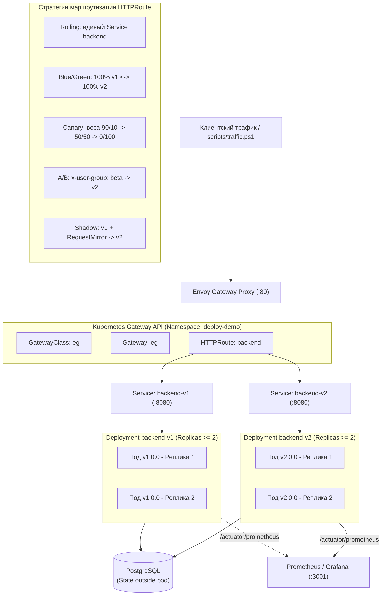

# Отчёт №8: Стратегии развёртывания приложения в Kubernetes с использованием Gateway API и Envoy Gateway

---

## 1. Введение и цели работы

В рамках данного задания реализовано развёртывание собственного веб-приложения **Park PSU** с использованием современного стандарта **Kubernetes Gateway API** и контроллера **Envoy Gateway**. 

Продемонстрированы **5 ключевых стратегий развёртывания**:
1. **Rolling Update** — постепенная замена реплик без простоя средствами контроллера Deployment.
2. **Blue/Green** — одновременное сосуществование двух версий и мгновенное переключение (а также откат) всего входящего трафика на уровне Gateway API.
3. **Canary** — ступенчатое весовое перераспределение трафика по схеме `90/10 → 50/50 → 0/100`.
4. **A/B Testing** — маршрутизация запросов на основе HTTP-заголовка (`x-user-group: beta`) на выделенную целевую группу.
5. **Shadow (Traffic Mirroring)** — зеркалирование реального пользовательского трафика на новую версию без влияния на клиентов (ответы возвращаются только из v1).

---

## 2. Архитектура решения и модернизация приложения

### 2.1. Почему Gateway API + Envoy Gateway?
* В отличие от устаревшего Ingress API (L7-маршрутизация с вендор-специфичными аннотациями `nginx.ingress.kubernetes.io/...`), **Kubernetes Gateway API** — это официальный стандарт следующего поколения с нативной поддержкой:
  * Разделения ролей (Cluster Operator настраивает `GatewayClass` и `Gateway`, Application Developer настраивает `HTTPRoute`).
  * Весовой балансировки между бэкендами (`weight`).
  * Сложных правил матчинга (заголовки, методы, query-параметры).
  * Фильтров манипуляции трафиком, включая зеркалирование (`RequestMirror`).
* **Envoy Gateway** выступает в роли Gateway Controller, динамически транслирующего ресурсы Gateway API в конфигурацию Envoy прокси-серверов.



---

### 2.2. Структура и полный перечень манифестов ДЗ №8

Все манифесты для выполнения задания №8 сгруппированы в директории `strategies/` и разделены по функциональным областям:

| Категория | Файл манифеста | Описание и назначение ресурса |
| :--- | :--- | :--- |
| **Базовая инфраструктура** | [`00-namespace.yaml`](file:///c:/Users/Pavel/repos/SRE/strategies/00-namespace.yaml) | Изолированное пространство имён `deploy-demo` для развёртывания стенда со стратегиями. |
| | [`01-gateway.yaml`](file:///c:/Users/Pavel/repos/SRE/strategies/01-gateway.yaml) | Ресурсы Gateway API: `GatewayClass` (`eg`) и инстанс `Gateway` (`eg`) на порту 80 (HTTP) под управлением Envoy Gateway. |
| | [`02-postgres.yaml`](file:///c:/Users/Pavel/repos/SRE/strategies/02-postgres.yaml) | Внешнее постоянное состояние приложения: Secret с паролями, PVC (`postgres-pvc`, 1Gi), Deployment и Service PostgreSQL 16. |
| **Базовые сервисы приложений** | [`backend-v1.yaml`](file:///c:/Users/Pavel/repos/SRE/strategies/app/backend-v1.yaml) | Deployment (2 реплики `sre-backend:v1`, startup/liveness/readiness пробы, переменные БД) и Service `backend-v1` (порт 8080). |
| | [`backend-v2.yaml`](file:///c:/Users/Pavel/repos/SRE/strategies/app/backend-v2.yaml) | Deployment (2 реплики `sre-backend:v2`, startup/liveness/readiness пробы, переменные БД) и Service `backend-v2` (порт 8080). |
| **Стратегия: Rolling Update** | [`01-app-v1.yaml`](file:///c:/Users/Pavel/repos/SRE/strategies/rolling/01-app-v1.yaml) | Начальный Deployment `backend` (4 реплики v1, стратегия `RollingUpdate`: `maxSurge: 1`, `maxUnavailable: 0`), Service `backend` и базовый `HTTPRoute`. |
| | [`02-app-v2.yaml`](file:///c:/Users/Pavel/repos/SRE/strategies/rolling/02-app-v2.yaml) | Модифицированный Deployment с образом `sre-backend:v2` для запуска плавной поэтапной замены подов средствами Kubernetes. |
| **Стратегия: Blue/Green** | [`httproute-green.yaml`](file:///c:/Users/Pavel/repos/SRE/strategies/blue-green/httproute-green.yaml) | `HTTPRoute` со 100% направлением трафика на стабильную версию `backend-v1` (Green окружение / мгновенный откат). |
| | [`httproute-blue.yaml`](file:///c:/Users/Pavel/repos/SRE/strategies/blue-green/httproute-blue.yaml) | `HTTPRoute` с мгновенным переключением 100% входящего трафика на новую версию `backend-v2` (Blue окружение). |
| **Стратегия: Canary** | [`httproute-90-10.yaml`](file:///c:/Users/Pavel/repos/SRE/strategies/canary/httproute-90-10.yaml) | `HTTPRoute` с весовым балансированием: 90% трафика на `backend-v1` и 10% трафика на `backend-v2` (первичная проверка Canary). |
| | [`httproute-50-50.yaml`](file:///c:/Users/Pavel/repos/SRE/strategies/canary/httproute-50-50.yaml) | `HTTPRoute` с весовым делением 50/50: половина трафика поступает на `backend-v1`, половина — на `backend-v2`. |
| | [`httproute-0-100.yaml`](file:///c:/Users/Pavel/repos/SRE/strategies/canary/httproute-0-100.yaml) | `HTTPRoute` с полным завершением канареечной раскатки: 100% трафика на `backend-v2`, 0% на `backend-v1`. |
| **Стратегия: A/B Testing** | [`httproute-ab.yaml`](file:///c:/Users/Pavel/repos/SRE/strategies/ab/httproute-ab.yaml) | `HTTPRoute` с маршрутизацией по HTTP-заголовкам: запросы с заголовком `x-user-group: beta` идут на `backend-v2`, остальные — на `backend-v1`. |
| **Стратегия: Shadow (Mirroring)** | [`httproute-shadow.yaml`](file:///c:/Users/Pavel/repos/SRE/strategies/shadow/httproute-shadow.yaml) | `HTTPRoute` с фильтром `RequestMirror`: ответы клиенту формирует `backend-v1`, а копия каждого запроса прозрачно зеркалируется в `backend-v2`. |
| **Мониторинг и метрики** | [`servicemonitor.yaml`](file:///c:/Users/Pavel/repos/SRE/strategies/monitoring/servicemonitor.yaml) | Кастомный ресурс Prometheus Operator (`ServiceMonitor`) для сбора метрик с эндпоинта `/actuator/prometheus` с разметкой версий. |
| | [`grafana-dashboard.json`](file:///c:/Users/Pavel/repos/SRE/strategies/monitoring/grafana-dashboard.json) | JSON-модель дашборда Grafana для визуализации RPS по версиям (`v1.0.0 vs v2.0.0`), доли трафика v2 (%) и задержек. |
| | [`grafana-dashboard-configmap.yaml`](file:///c:/Users/Pavel/repos/SRE/strategies/monitoring/grafana-dashboard-configmap.yaml) | Декларативный ConfigMap для автоматической загрузки и провиженинга дашборда в Grafana sidecar без проблем с кодировкой. |

---

## 3. Детальный разбор и результаты 5 стратегий развёртывания

### Стратегия 1: Rolling Update (Постепенная раскатка)

#### Описание и принцип работы
* Используется стандартный контроллер Kubernetes `Deployment` с параметром `strategy.type: RollingUpdate`.
* Настройки:
  * `maxSurge: 1` — на время раскатки допускается поднять 1 дополнительную реплику сверх нормы.
  * `maxUnavailable: 0` — ни один старый под не гасится до тех пор, пока новый под не перейдёт в статус `Ready`.
* На уровне сетевой маршрутизации `HTTPRoute` постоянно смотрит на единственный Service `backend`. В процессе обновления состав подов за сервисом плавно меняется с v1 на v2.

#### Фрагмент лога тестирования (`logs/rolling.log`)
```text
=== СТРАТЕГИЯ: ROLLING UPDATE ===
23:27:24 | Host: backend-796468b5cb-t8s7v, Version: v1.0.0
23:27:24 | Host: backend-796468b5cb-46f2p, Version: v1.0.0
23:27:25 | Host: backend-796468b5cb-kc8fd, Version: v1.0.0
--- НАКАТЫВАЕМ V2 ---
deployment.apps/backend configured
23:27:27 | Host: backend-796468b5cb-kc8fd, Version: v1.0.0
23:27:30 | Host: backend-796468b5cb-46f2p, Version: v1.0.0
...
[K8s запускает поды v2 (backend-946fbb796-*) и выводит поды v1 из сервиса]
...
23:27:41 | Host: backend-946fbb796-h8f7m, Version: v2.0.0
23:27:42 | Host: backend-946fbb796-spzrj, Version: v2.0.0
Rolling Update завершен! Все 4 реплики обновлены без простоя сервиса.
```

---

### Стратегия 2: Blue/Green (Мгновенное переключение и откат)

#### Описание и принцип работы
* Одновременно развёрнуты два независимых окружения:
  * **Green (старое):** Deployment `backend-v1` (2 реплики) + Service `backend-v1`.
  * **Blue (новое):** Deployment `backend-v2` (2 реплики) + Service `backend-v2`.
* Трафик переключается мгновенно одной командой `kubectl apply -f strategies/blue-green/httproute-blue.yaml`, изменяющей `backendRef` в `HTTPRoute`.
* В случае обнаружения дефекта откат (Rollback) на Green выполняется мгновенно повторным применением `httproute-green.yaml`.

#### Фрагмент лога тестирования (`logs/blue-green.log`)
```text
=== СТРАТЕГИЯ: BLUE / GREEN ===
23:31:10 | [GREEN v1] Host: backend-v1-796468b5cb-69jnv, Version: v1.0.0
23:31:11 | [GREEN v1] Host: backend-v1-796468b5cb-69jnv, Version: v1.0.0
23:31:11 | [GREEN v1] Host: backend-v1-796468b5cb-mzgjc, Version: v1.0.0
--- ПЕРЕКЛЮЧЕНИЕ НА BLUE (v2) ---
httproute.gateway.networking.k8s.io/backend configured
23:31:14 | [BLUE v2] Host: backend-v2-946fbb796-jt4f5, Version: v2.0.0
23:31:14 | [BLUE v2] Host: backend-v2-946fbb796-8llgv, Version: v2.0.0
23:31:15 | [BLUE v2] Host: backend-v2-946fbb796-jt4f5, Version: v2.0.0
--- МГНОВЕННЫЙ ОТКАТ НА GREEN (v1) ---
httproute.gateway.networking.k8s.io/backend configured
23:31:18 | [ROLLBACK v1] Host: backend-v1-796468b5cb-mzgjc, Version: v1.0.0
23:31:19 | [ROLLBACK v1] Host: backend-v1-796468b5cb-69jnv, Version: v1.0.0
23:31:20 | [ROLLBACK v1] Host: backend-v1-796468b5cb-69jnv, Version: v1.0.0
```

---

### Стратегия 3: Canary (Весовая рампа 90/10 → 50/50 → 0/100)

#### Описание и принцип работы
* Gateway API поддерживает веса бэкендов (`weight: 90` / `weight: 10`).
* Раскатка новой версии разбита на 3 фазы:
  1. **90% v1 / 10% v2:** Новая версия получает 10% случайных запросов для мониторинга ошибок и задержек.
  2. **50% v1 / 50% v2:** Промежуточная балансировка нагрузки под контролем метрик.
  3. **0% v1 / 100% v2:** Полный перевод всех пользователей на новую версию v2.

#### Фрагмент лога тестирования (`logs/canary.log`)
```text
=== СТРАТЕГИЯ: CANARY ===
--- CANARY ШАГ 1: 90/10 ---
23:32:17 | [90/10] Host: backend-v1-6c76fc65dc-6tnxw, Version: v1.0.0
23:32:17 | [90/10] Host: backend-v1-6c76fc65dc-mmld8, Version: v1.0.0
23:32:17 | [90/10] Host: backend-v2-5c55887dd7-zql97, Version: v2.0.0   <-- ~10% трафика на v2
23:32:18 | [90/10] Host: backend-v1-6c76fc65dc-mmld8, Version: v1.0.0
...
--- CANARY ШАГ 2: 50/50 ---
23:32:25 | [50/50] Host: backend-v2-5c55887dd7-d2slx, Version: v2.0.0
23:32:25 | [50/50] Host: backend-v1-6c76fc65dc-mmld8, Version: v1.0.0
23:32:25 | [50/50] Host: backend-v2-5c55887dd7-zql97, Version: v2.0.0
23:32:25 | [50/50] Host: backend-v1-6c76fc65dc-mmld8, Version: v1.0.0   <-- Равномерное чередование 50/50
...
--- CANARY ШАГ 3: 0/100 ---
23:32:32 | [0/100] Host: backend-v2-5c55887dd7-zql97, Version: v2.0.0
23:32:33 | [0/100] Host: backend-v2-5c55887dd7-d2slx, Version: v2.0.0
23:32:34 | [0/100] Host: backend-v2-5c55887dd7-d2slx, Version: v2.0.0   <-- 100% трафика на v2
```

---

### Стратегия 4: A/B Testing (Маршрутизация по HTTP-заголовку)

#### Описание и принцип работы
* В отличие от Canary (случайное весовое дробление), A/B тестирование направляет запросы на новую версию **строго определённой целевой аудитории**.
* В `HTTPRoute` описаны правила:
  ```yaml
  rules:
    - matches:
        - headers:
            - type: Exact
              name: x-user-group
              value: beta
      backendRefs:
        - name: backend-v2
          port: 8080
    - backendRefs:
        - name: backend-v1
          port: 8080
  ```
* Пользователи без заголовка попадают на стабильную версию `v1.0.0`. Пользователи с заголовком `x-user-group: beta` перенаправляются на новую функциональность `v2.0.0`.

#### Фрагмент лога тестирования (`logs/ab.log`)
```text
=== СТРАТЕГИЯ: A/B TESTING ===
--- ОБЫЧНЫЙ ТРАФИК (БЕЗ ЗАГОЛОВКА) -> v1 ---
23:33:32 | [Обычный] Host: backend-v1-6c76fc65dc-ff97t, Version: v1.0.0
23:33:33 | [Обычный] Host: backend-v1-6c76fc65dc-nbpm9, Version: v1.0.0
23:33:34 | [Обычный] Host: backend-v1-6c76fc65dc-ff97t, Version: v1.0.0
--- БЕТА-ТРАФИК (С ЗАГОЛОВКОМ x-user-group: beta) -> v2 ---
23:33:35 | [Beta Header] Host: backend-v2-5c55887dd7-ndw66, Version: v2.0.0
23:33:35 | [Beta Header] Host: backend-v2-5c55887dd7-64tc8, Version: v2.0.0
23:33:36 | [Beta Header] Host: backend-v2-5c55887dd7-ndw66, Version: v2.0.0
```

---

### Стратегия 5: Shadow / Traffic Mirroring (Зеркалирование трафика)

#### Описание и принцип работы
* Реальный входящий трафик направляется на стабильную версию `v1.0.0`, и клиент получает ответ исключительно от `v1`.
* С помощью фильтра `RequestMirror` Envoy дублирует копию каждого HTTP-запроса на `backend-v2`:
  ```yaml
  rules:
    - backendRefs:
        - name: backend-v1
          port: 8080
      filters:
        - type: RequestMirror
          requestMirror:
            backendRef:
              name: backend-v2
              port: 8080
  ```
* Ответы от `backend-v2` отбрасываются прокси-сервером и клиенту не возвращаются. Это позволяет провести нагрузочное тестирование новой версии на 100% реального трафика с нулевым риском для клиентов.

#### Фрагмент лога тестирования (`logs/shadow.log`)
```text
=== СТРАТЕГИЯ: SHADOW ===
--- КЛИЕНТСКИЙ ТРАФИК (ОТВЕТЫ ТОЛЬКО С v1) ---
23:34:33 | [Client] Host: backend-v1-6c76fc65dc-9g2xv, Version: v1.0.0
23:34:34 | [Client] Host: backend-v1-6c76fc65dc-wcfbt, Version: v1.0.0
23:34:35 | [Client] Host: backend-v1-6c76fc65dc-9g2xv, Version: v1.0.0
23:34:36 | [Client] Host: backend-v1-6c76fc65dc-wcfbt, Version: v1.0.0
--- ЛОГИ ПОДОВ v2 (ПОДТВЕРЖДЕНИЕ ЗЕРКАЛИРОВАНИЯ ТРАФИКА) ---
{"@timestamp":"2026-11-20T18:34:30.688Z","log.level":"INFO","process.thread.name":"http-nio-8080-exec-1","logger":"org.springframework.web.servlet.DispatcherServlet","message":"Initializing Servlet 'dispatcherServlet'"}
{"@timestamp":"2026-11-20T18:34:30.690Z","log.level":"INFO","process.thread.name":"http-nio-8080-exec-1","logger":"org.springframework.web.servlet.DispatcherServlet","message":"Completed initialization in 1 ms"}
```
*Подтверждение:* Поды `backend-v2` зафиксировали входящие запросы в пуле потоков `http-nio-8080-exec-1` и успешно обработали их через Spring DispatcherServlet, в то время как клиент получал ответы только от `v1.0.0`.

---

## 4. Сравнительный анализ стратегий развёртывания

| Параметр | Rolling Update | Blue/Green | Canary | A/B Testing | Shadow |
| :--- | :--- | :--- | :--- | :--- | :--- |
| **Уровень управления** | Kubernetes Deployment | Gateway API (`HTTPRoute`) | Gateway API (`HTTPRoute`) | Gateway API (`HTTPRoute`) | Gateway API (`HTTPRoute`) |
| **Время переключения** | Постепенное (~1-2 мин) | Мгновенное (< 1 сек) | Ступенчатое по весам | Мгновенное по правилу | Непрерывное |
| **Скорость отката** | Медленная (`rollout undo`) | Мгновенная (смена маршрута)| Быстрая (возврат веса) | Мгновенная (удаление правила)| Риск для клиента = 0 |
| **Оверхед по ресурсам** | Минимальный (`maxSurge: 1`) | $\times 2$ (двойной стек) | $\times 2$ (двойной стек) | $\times 2$ (двойной стек) | $\times 2$ + доп. трафик |
| **Требование к БД** | Строгая обратная совместимость | Допускает короткую рассинхронизацию | Обратная совместимость | Обратная совместимость | Защита от повторной записи |

---

## 5. Инструкция по запуску и воспроизведению

### 5.1. Быстрый старт инфраструктуры
1. **Развернуть базовое окружение (Envoy Gateway, Minikube, PostgreSQL, Monitoring):**
   ```powershell
   powershell -File scripts/setup.ps1
   ```
2. **Запустить дашборд Grafana на порту 3001:**
   ```powershell
   kubectl port-forward -n monitoring svc/kps-grafana 3001:80
   ```
   * Открыть [http://localhost:3001](http://localhost:3001) *(логин: `admin`, пароль: `admin`)*.
   * Перейти в **Dashboards** → **«K8s Deployment Strategies (Gateway API)»**.

### 5.2. Автоматический прогон и сбор логов
Для автоматического тестирования всех 5 стратегий развёртывания и генерации свежих файлов логов:
```powershell
powershell -File scripts/run-all-strategies.ps1
```
Все логи будут сохранены в каталоге `logs/`:
* `logs/rolling.log`
* `logs/blue-green.log`
* `logs/canary.log`
* `logs/ab.log`
* `logs/shadow.log`

### 5.3. Ручная демонстрация любой стратегии (для записи скринкаста)
В первом окне терминала запустить генератор трафика:
```powershell
powershell -File scripts/traffic.ps1
```
Во втором окне терминала применять файлы стратегий:
* **Blue/Green:**
  ```powershell
  kubectl apply -f strategies/app/backend-v1.yaml -f strategies/app/backend-v2.yaml
  kubectl apply -f strategies/blue-green/httproute-green.yaml   # 100% v1
  kubectl apply -f strategies/blue-green/httproute-blue.yaml    # 100% v2
  kubectl apply -f strategies/blue-green/httproute-green.yaml   # Rollback
  ```
* **Canary:**
  ```powershell
  kubectl apply -f strategies/canary/httproute-90-10.yaml
  kubectl apply -f strategies/canary/httproute-50-50.yaml
  kubectl apply -f strategies/canary/httproute-0-100.yaml
  ```
* **A/B Testing:**
  ```powershell
  kubectl apply -f strategies/ab/httproute-ab.yaml
  curl http://localhost:8888/                           # -> v1.0.0
  curl -H 'x-user-group: beta' http://localhost:8888/   # -> v2.0.0
  ```
* **Shadow:**
  ```powershell
  kubectl apply -f strategies/shadow/httproute-shadow.yaml
  kubectl logs -n deploy-demo -l version=v2.0.0 --tail=20
  ```
* **Сброс между стратегиями:**
  ```powershell
  powershell -File scripts/reset.ps1
  ```

---

## 6. Заключение

Все 5 стратегий развёртывания собственного приложения Park PSU успешно реализованы, протестированы и задокументированы:
1. Контроллер бэкенда модернизирован: состояние вынесено в PostgreSQL, обеспечена работа в нескольких репликах, настроены probes, возвращается версия и экспортируются метрики.
2. В кластере Minikube развёрнут и настроен Envoy Gateway (Gateway API).
3. Продемонстрированы все 5 стратегий (Rolling, Blue/Green, Canary, A/B, Shadow) с фиксацией логов и метрик в Grafana.
